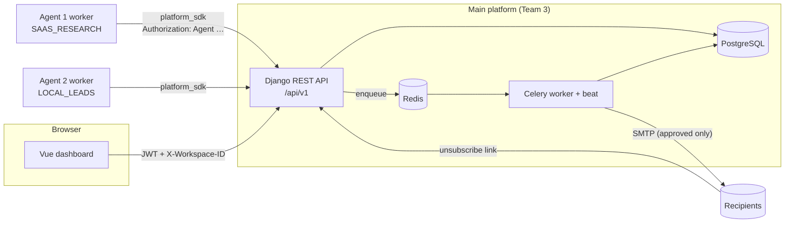

# System Architecture

## Principles
1. **Backend is the source of truth.** Agents never touch the DB; they read tasks and write results only through the Agent API.
2. **Pull model with leases** (ADR-003). Agents claim `QUEUED` tasks for their agent type, renew a lease by heartbeat, then submit results and complete/fail. Crashed workers lose the lease; the backend re-queues or fails the task.
3. **Approval gates are enforced in the backend** (ADR-005): state machines + content hashes. No agent credential can reach a decision or send endpoint.
4. **One result format** (Result Bundle v1.0) for both agents → one persistence path, one validation layer, idempotent retries.
5. **Multi-tenant by workspace.** Every business record has `workspace_id`. Agent tokens are platform-level and see only tasks of their agent type; the workspace is implied by the task.

## Backend apps
| App | Owns |
|---|---|
| `accounts` | User (email login, UUID), Workspace (tenant + sender identity + outreach policy), Membership (role) |
| `orchestration` | ResearchTask (agent job + progress + lease), AgentToken, ResultRef, result-bundle ingestion, Agent API |
| `research` | Evidence, Opportunity, SoftwareIdea |
| `leads` | Business (deduplicated), Lead, ProjectBrief |
| `outreach` | Campaign, OutreachMessage, SuppressionEntry, **the only send path**, unsubscribe |
| `approvals` | Approval + decision side effects |
| `integrations` | Integration (encrypted, write-only secrets) |
| `audit` | AuditEvent (append-only) |
| `dashboard` | Summary aggregates |

Services hold business logic (`apps/*/services.py`); views stay thin. Status enums live in one file: `backend/apps/common/enums.py`.

## Background processing
- Celery tasks: `outreach.send_campaign_batch`, `outreach.resume_active_campaigns` (beat, 5 min), `orchestration.reap_expired_leases` (beat, 60 s; also run lazily on every claim).
- Agent work is **not** run by Celery; agents are separate processes using the SDK. Celery task ids are internal; the public background-task id is always `ResearchTask.id`.

## Authentication
| Caller | Mechanism | Scope |
|---|---|---|
| Human (Vue) | JWT Bearer (`/auth/token/`, 15 min access / 7 d rotating refresh) + `X-Workspace-ID` | Workspace role: VIEWER < DEVELOPER < ADMIN < OWNER |
| Agent worker | `Authorization: Agent agt_<prefix>_<secret>` (SHA-256 stored) | Only `/api/v1/agent/*`, only its agent type, writes require the task's current `X-Lease-Id` |
| Recipient | Signed token in unsubscribe link | Only `/api/v1/public/unsubscribe/<token>/` |

## LLM providers (convention for agent teams)
Agents own their LLM usage. Use a provider-agnostic adapter inside the agent package configured by env: `LLM_PROVIDER` (`anthropic`|`openai`|…), `LLM_MODEL`, `LLM_API_KEY`. Default recommendation: Anthropic Claude (latest Sonnet/Opus tier). Keys are deployment secrets — never in code, bundles, or task input. A workspace-level `Integration(kind=LLM)` exists in the schema for future per-workspace keys but is **not yet exposed to agents** (see INTEGRATION_STATUS).

## Security & compliance controls (implemented)
- No hardcoded secrets: settings fail fast without `DJANGO_SECRET_KEY`/`DATABASE_URL`; tests generate random keys.
- Integration secrets Fernet-encrypted (`FIELD_ENCRYPTION_KEY`), never returned by the API.
- Every state change and decision writes an `AuditEvent` (actor USER/AGENT/SYSTEM).
- Evidence (source URL, type, excerpt, retrieved_at) attached to opportunities, ideas, businesses, leads, briefs, problems.
- Suppression list (email/domain/phone) checked at draft ingestion and again immediately before every send; adding an entry suppresses all pending messages.
- Every email: sender identity + postal address + opt-out link footer, RFC 8058 `List-Unsubscribe` headers.
- Send blocked when: legal basis `UNKNOWN`; recipient country in workspace `consent_required_countries` without `CONSENT`; lead disqualified/archived; sender identity incomplete; content changed after approval.
- Daily send limit per workspace; at-most-once sending (`SENDING` committed before the SMTP call).

> Legal note: these are technical controls, not legal advice. Workspace owners must configure `consent_required_countries` and legitimate-interest assessments for their jurisdictions.
